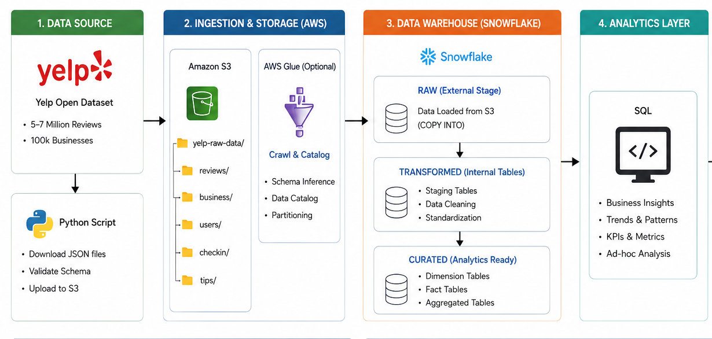

# End-to-End Data Analytics Pipeline

End-to-End Data Analytics Project using Python, AWS S3, Snowflake and SQL.

## 📌 Overview

This project analyzes the Yelp Open Dataset containing business and review data.

The pipeline uses Python to process JSON files, AWS S3 for storage, Snowflake for data warehousing, and SQL for analysis.

## 🏗️ Architecture



```text
Yelp JSON Dataset
       ↓
     Python
       ↓
    AWS S3
       ↓
   Snowflake
       ↓
  Data Cleaning
       ↓
    SQL Analysis
       ↓
 Business Insights